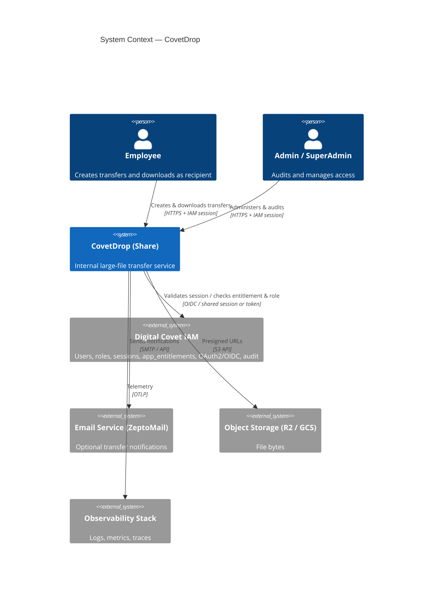
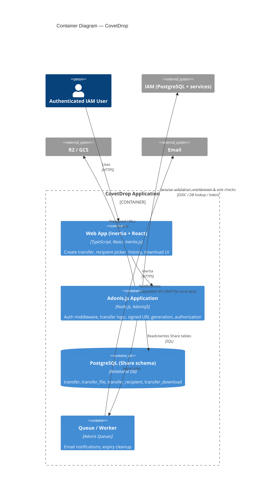
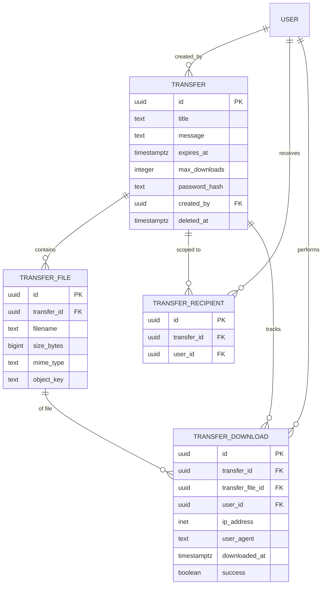

# CovetDrop — Architecture

## 1. Overview

**Problem:**  
Employees at Digital Covet need a simple, secure internal service to send large files to specific colleagues without email attachments or external consumer tools. Access is governed by the existing IAM system.

**Target users:**  
Internal employees authenticated via Digital Covet IAM. Roles: Employee (create and receive transfers), Admin, SuperAdmin. Access to the Share application itself is controlled by `app_entitlement`.

**Core capabilities:**

- Create a transfer with title, message, one or more files (≤5 GiB each), optional password, expiry, and max downloads
- Scope recipients explicitly via `transfer_recipient` (specific IAM users)
- Generate download capability for entitled recipients (authenticated)
- Full download tracking (`transfer_download`)
- Direct-to-cloud upload/download via presigned URLs

**Assumptions:**

- Single organization; IAM is the system of record for users, roles, sessions, and app entitlements
- Share service has its own PostgreSQL schema (or same database with clear ownership); foreign keys to `user.id` are logical or enforced via shared DB
- Recipients must be authenticated IAM users who appear in `transfer_recipient` (or the creator). No anonymous public links in the current schema
- File size hard limit of 5 GiB per `transfer_file` constraint
- Password is stored as a hash and gates access after authentication
- “Team member scoping” is implemented as explicit per-user recipients rather than a separate team entity (no team table exists in IAM)
- Moderate scale: hundreds of users, thousands of transfers

**Non-goals:**

- Anonymous external recipients
- Public link sharing without IAM login
- Full multi-tenancy
- In-file search or collaboration

## 2. System Context

- **Primary actors:** Authenticated Employees (creators and recipients), Admins
- **External systems:** IAM (identity, sessions, entitlements, roles), Object storage, Email, Observability
- **Trust boundaries:** All interactive access requires a valid IAM session and `app_entitlement` for the Share app. Download resolution additionally checks `transfer_recipient` membership (or creator).

## 3. Container Architecture

| Container | Responsibility | Technology | Communication |
|-----------|----------------|------------|---------------|
| Web App | Transfer creation, recipient selection (from IAM users), download UI | Inertia.js + React | Inertia to Adonis |
| Adonis.js Application | Business logic, IAM integration, Drive signed URLs, authorization against recipients & roles | AdonisJS + Lucid + Drive | SQL, S3, IAM |
| Share PostgreSQL | Transfer metadata only | PostgreSQL | — |
| IAM | Users, roles, sessions, app_entitlements, audit | Existing IAM | OIDC / shared auth |
| Object Storage | File bytes | Cloudflare R2 or GCP | Presigned URLs |
| Queue | Notifications & cleanup | Adonis Queue | — |

## 4. Data Model

The Share service owns the following tables (as provided). User references point to IAM’s `user` table.

| Entity | Key fields | Storage | Notes |
|--------|------------|---------|-------|
| transfer | title, message, expires_at, max_downloads, password_hash, created_by | Share PostgreSQL | Soft-delete via deleted_at; max_downloads CHECK |
| transfer_file | filename, size_bytes (≤5 GiB), object_key | Share PostgreSQL | Metadata only |
| transfer_recipient | transfer_id + user_id (unique) | Share PostgreSQL | Implements scoping; only these users (plus creator) may download |
| transfer_download | user_id (required), ip, user_agent, success | Share PostgreSQL | Full audit of every download attempt |

**IAM entities used:**

- `user` (id, email, name, role_id)
- `role` + `role_permission` + `permission`
- `session`
- `app` + `app_entitlement` (must have entitlement for the Share app)
- `audit_log` (IAM side; Share can also write its own or emit to IAM)

**Consistency:** Strong consistency on Share metadata. Download count / max_downloads enforcement done inside a transaction when recording a `transfer_download`. Object storage is authoritative for bytes. Expired transfers cleaned by scheduled job (set deleted_at + delete objects).

## 5. Key APIs & Interfaces

| Interface | Type | Purpose | Auth |
|-----------|------|---------|------|
| POST /transfers | Inertia | Create transfer + recipients; return presigned upload URLs | IAM session + app_entitlement |
| POST /transfers/:id/complete | REST | Confirm files uploaded; activate transfer | IAM |
| GET /transfers | Inertia | List transfers I created or am recipient of | IAM |
| GET /transfers/:id | Inertia | Details + download actions | IAM + (creator or in transfer_recipient) |
| POST /transfers/:id/download/:fileId | REST | Check password / expiry / max / recipient; record transfer_download; return presigned GET | IAM + recipient check |
| DELETE /transfers/:id | REST | Soft-delete | Creator or Admin |
| IAM session / OIDC | — | Authentication & entitlement | — |
| Drive presigned URLs | S3 | Direct upload & download | Server credentials only |

All download paths require an authenticated user who is either the creator or listed in `transfer_recipient`. Optional password is verified server-side against `password_hash` before issuing the presigned URL.

## 6. Technology Stack

| Layer | Choice | Rationale |
|-------|--------|-----------|
| Frontend | Inertia.js + React + TypeScript | Requested; server-driven, simple auth integration |
| Backend | Adonis.js | Requested; native Drive, Lucid, queues, middleware |
| Share Data | PostgreSQL | Matches provided schema |
| Identity | Existing IAM (OIDC + sessions + app_entitlement) | Constraint; no local user store |
| Object Storage | Cloudflare R2 (preferred) or GCP Cloud Storage | Zero-egress preference; Adonis Drive support; 5 GiB fits single/multipart |
| Async | Adonis Queues | Notifications & cleanup |
| Infrastructure | Containers | Horizontal scaling of stateless Adonis |

## 7. Security

- **Authentication:** IAM session or OIDC access token validated on every request. Middleware checks `app_entitlement` for the Share application.
- **Authorization:** 
  - Role-based (Employee / Admin / SuperAdmin) via IAM `role` + permissions for admin actions.
  - Resource-based: only creator or users in `transfer_recipient` may view/download a transfer.
  - Optional password: bcrypt/argon2 hash checked before issuing presigned download URL.
- **Data protection:** Objects encrypted at rest by R2/GCS. Presigned URLs short-lived. Password never stored in plaintext. Soft deletes preserve auditability.
- **Secrets:** Storage credentials and any IAM client secrets in secret manager.
- **Threats:** Unauthorized download (blocked by recipient check + auth), link sharing outside org (mitigated by requiring IAM login), oversized uploads (enforced by schema + Drive config), audit gaps (mitigated by `transfer_download` + IAM `audit_log`).

## 8. Scalability & Performance

- **Expected load:** Internal team (hundreds of users). Direct-to-storage keeps app servers lightweight.
- **Horizontal scaling:** Stateless Adonis replicas. Postgres and R2 scale independently.
- **Caching:** Cache IAM user/role/entitlement claims briefly (in-memory).
- **Bottlenecks:** Download tracking inserts are append-only and indexed; cleanup job for expired transfers. Presign generation is cheap.

## 9. Deployment & Infrastructure

- **Environments:** dev / staging / prod with isolated Share databases and storage buckets.
- **CI/CD:** Standard container build + Adonis migrations.
- **Infrastructure:** Containerized Adonis; managed PostgreSQL for Share schema; R2/GCS; IAM remains external.
- **Observability:** Structured logs, traces on transfer creation and download resolution, metrics for download success/failure and storage usage. Leverage or mirror IAM `audit_log` patterns.

## 10. Risks, Trade-offs & Open Questions

| Risk / Trade-off | Impact | Mitigation or Decision Needed |
|------------------|--------|-------------------------------|
| No anonymous recipients | Cannot send to external parties without IAM accounts | Accept as current design; add public token later if needed |
| Shared vs separate DB for user FK | Referential integrity | Prefer logical FK + periodic sync, or same database |
| 5 GiB hard limit | May be restrictive | Raise if storage provider and Drive allow; update CHECK |
| Password model | Gates access but does not encrypt object | Sufficient for internal; document clearly |
| Entitlement + recipient checks | Extra round-trips to IAM | Cache entitlements; fail closed |
| Cleanup of objects | Orphaned files if job fails | Lifecycle rules on bucket + idempotent cleanup job |

**Open questions:**

- Is the Share schema in the same PostgreSQL instance as IAM or separate?
- Exact mechanism for validating IAM sessions from Adonis (shared cookie domain, token introspection, or OIDC)?
- Should creators automatically be able to download without being in `transfer_recipient`?
- Notification content and whether email is mandatory or optional?
- Admin visibility: can Admins see all transfers or only those in their scope?

---

*Updated to match the provided IAM and Share schemas. Team scoping is realized via* `transfer_recipient`*. All interactive access requires IAM authentication and app entitlement.*
